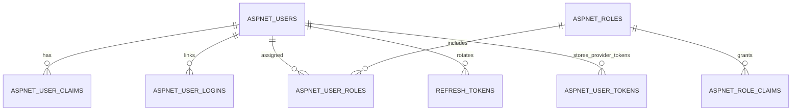

# QuizFlow architecture and Phase 1 plan

## Architecture

QuizFlow starts as a modular monolith. Angular SSR serves the web experience and calls a versioned ASP.NET Core API. The API owns authentication, application use cases, validation and authorization. Infrastructure owns EF Core/Npgsql persistence, email delivery and external identity adapters. PostgreSQL is the source of truth. Redis, background jobs, object storage and SignalR scale-out are introduced with their product phases, not as Phase 1 dependencies.

Target flow: `Angular SSR/client -> ASP.NET Core API -> Application -> Domain`; Infrastructure implements Application ports and persists through EF Core. The API composition root wires the providers. Identity uses ASP.NET Core Identity with secure password hashing. Short-lived access tokens are JWTs; opaque refresh tokens are rotated on every refresh and only their hashes are persisted. One-time email/password tokens use Identity's token providers and must be sent through the configured email abstraction.

Google sign-in uses OpenID Connect authorization code flow, signed state and nonce, and verified `email` claims. A Google subject is linked to an existing local account only when the provider asserts a verified email matching the account, otherwise sign-in fails and the user must authenticate locally before linking. Secrets are configuration only. OAuth callback issues the same application access/refresh credentials as password sign-in.

## Backend structure

```text
src/backend/
  QuizFlow.Api/                 HTTP endpoints, middleware, auth policies, composition
  QuizFlow.Application/         use cases, DTOs, validation and service contracts
  QuizFlow.Domain/              entities, value objects and domain rules
  QuizFlow.Infrastructure/      Identity, EF Core/Npgsql, email and provider adapters
tests/
  QuizFlow.UnitTests/           isolated domain/application tests
  QuizFlow.IntegrationTests/    PostgreSQL-backed API/auth tests (later in Phase 1)
```

## Angular structure

```text
src/frontend/src/app/
  core/       API client, auth state, route guards, interceptors
  features/   auth, dashboard and subsequent product modules
  shared/     reusable controls and design-system pieces
  app.routes.ts, app.config.ts, app.config.server.ts
```

Angular 22 with SSR is the current active Angular release; .NET 10 is the installed LTS SDK. Material supplies accessible controls and Tailwind provides utility styling. Signals/RxJS are used where each fits naturally.

## Initial database ERD



Initial tables are standard Identity users, roles, user claims, role claims, user-role joins, external logins and tokens, plus `RefreshTokens` (user FK, token hash, expiry, created/revoked/replaced metadata). Identity's token provider handles time-bound email confirmation and password reset tokens; raw tokens are emailed, never stored in application tables. Organization membership and business entities arrive in Phase 2 with mandatory organization scoping.

### Initial table design

| Table | Purpose and important columns | Constraints/indexes |
|---|---|---|
| `Users` | Identity user id, normalized username/email, password/security stamps, email-confirmed flag, lockout fields, first/last name, created timestamp | Unique normalized email; Identity username index |
| `AspNetRoles` | Role id, normalized role name | Unique normalized role name |
| `AspNetUserRoles` | User-to-role join | Composite primary key and foreign keys |
| `AspNetUserClaims` / `AspNetRoleClaims` | Extensible user and role claims | User/role foreign keys |
| `AspNetUserLogins` | External provider and provider subject | Unique provider/key pair; user foreign key |
| `AspNetUserTokens` | Protected Identity provider tokens | Composite user/provider/name key |
| `RefreshTokens` | Token id, user id, SHA-256 token hash, expiry, creation/revocation times, replacement hash, concurrency stamp | Unique token hash; `(UserId, ExpiresAt)` index; cascading user FK; optimistic concurrency stamp |

Email confirmation and password reset secrets are Data Protection tokens with a 30-minute lifetime, rather than persisted plaintext. The refresh secret is delivered in an HttpOnly, Secure, SameSite=Strict cookie; only its hash is stored in PostgreSQL. Access JWT lifetime is 15 minutes.

## Phase 1 endpoint contract

| Method | Route | Purpose |
|---|---|---|
| POST | `/api/v1/auth/register` | Create unconfirmed account and send verification |
| POST | `/api/v1/auth/login` | Password sign-in, access JWT and HttpOnly refresh cookie |
| POST | `/api/v1/auth/refresh` | Rotate the HttpOnly refresh cookie atomically and return a new access JWT |
| POST | `/api/v1/auth/logout` | Revoke current refresh token |
| POST | `/api/v1/auth/logout-all` | Revoke all sessions for the authenticated account |
| GET | `/api/v1/auth/me` | Return the current profile |
| PUT | `/api/v1/auth/me` | Update first and last name |
| POST | `/api/v1/auth/change-email` | Require current password and email a one-time confirmation link |
| POST | `/api/v1/auth/confirm-email-change` | Confirm the new address and revoke active sessions |
| POST | `/api/v1/auth/change-password` | Verify current password, update password, revoke sessions |
| POST | `/api/v1/auth/set-password` | Add a password to an OIDC-only account |
| DELETE | `/api/v1/auth/google` | Unlink Google while preserving another sign-in method |
| POST | `/api/v1/auth/verify-email` | Confirm email with time-limited token |
| POST | `/api/v1/auth/resend-verification` | Issue and email a new confirmation token |
| POST | `/api/v1/auth/forgot-password` | Request a reset (same response regardless of account existence) |
| POST | `/api/v1/auth/reset-password` | Set password with one-time token |
| GET | `/api/v1/auth/google` | Begin OIDC authorization challenge |
| GET | `/api/v1/auth/google/complete` | Complete the verified Google identity link and return credentials to the same-origin popup |
| GET | `/health` | Liveness/readiness entry point |

The OIDC middleware handles Google's authorization callback at `/signin-google`, including state, nonce, issuer, signature, and PKCE validation, then redirects to the application completion endpoint.

Database readiness is exposed at `GET /health/ready` and checks PostgreSQL connectivity.

## Development setup and roadmap

Prerequisites: .NET 10 SDK, Node.js 22+, npm, PostgreSQL 16+, and optional Docker. Configure `ConnectionStrings__Postgres`, `Jwt__Issuer`, `Jwt__Audience`, `Jwt__SigningKey`, `Google__ClientId`, `Google__ClientSecret`, SMTP provider settings, and `App__PublicUrl` through user secrets/environment variables. Apply EF migrations before running API; run Angular SSR separately in development. Never seed real credentials.

Phase 1 sequence: stabilize project scaffold and configuration; implement Identity/EF schema and migration; implement auth endpoints and email/OIDC adapters; implement Angular auth flows and API wiring; run backend/frontend builds and auth integration checks; update this plan and progress file. No real payment or production deployment is in scope.
